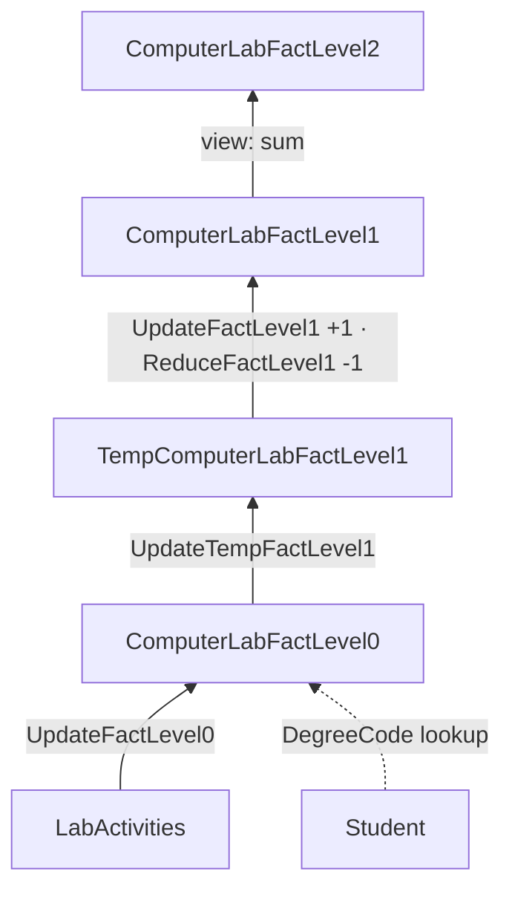

# [[Active Data Warehousing]]

**Context:** [[FIT3003_MOC]] · the warehouse that never stops loading — every rung of [[Levels of Aggregation|the granularity ladder]] kept current by [[SQL Views|views]] and [[Database Triggers (Oracle)|triggers]] · when the design itself must change ➔ [[Active Data Warehouse Evolution]]
**Parent Framework:** [[Data Warehouse]]

> [!abstract] Quick Revision
> - **🎯 Objective:** an update to the operational database is **immediately** reflected in the warehouse ➔ always up to date, **no longer purely historical**; exam payload = for each object choose **view** or **table $+$ trigger**, then trace one inserted row up every level.
> - **📦 Core Components:** **view** ➔ self-maintaining, no code (dimensions, measure-less facts, an upper fact that only re-aggregates a lower one) | **table $+$ trigger** ➔ anything storing a value the source does not hold (a count, a derived band, a looked-up key).
> - **⚡ Key Constraint:** **bottom-up only** ➔ each level is maintained from the level **immediately below**, so the Level-1 trigger fires on the Level-0 fact, never on the operational table; break one link and every level above silently freezes.

## 📝 How It Works
### 1. Passive vs active
- **Passive** ➔ once built, never changes: no insert, update or delete, so **PK–FK constraints between fact and dimensions are unnecessary**.
- **Active** ➔ dynamic: the source keeps writing into it, so **PK–FK constraints become important** to minimise anomalies from updates ➔ dimension PKs via `alter table … add constraint … primary key`, fact FKs to every dimension, fact **composite PK** over all dimension keys.
- **Architecture** ➔ raw operational databases ➔ one integrated operational database ➔ Level-0 ➔ Level-1 ➔ Level-2, each arrow a build dependency.
- **Build direction** ➔ active is **bottom-up** (Level-0 first, each upper level on the one immediately below); passive may do the same but is often easier **top-down** (start at a reasonable Level-2, lower step by step) ➔ [[Levels of Aggregation]].
- **Incremental ≠ merely automatic** ➔ three concerns: automatic updates (§2), **recentness** of the data (§3), and **changed rules** (§4).
- **Scope** ➔ inserts only; update and delete are "dealt with separately". Because the inter-dependencies are complex, active warehousing is used **only** where an application really needs active data.

### 2. Automatic updates — what each object becomes *(Computer Lab case)*
- **Dimension** ➔ `create or replace view … as select distinct …` over the operational table: new members appear with no code. **Kept as a table** ➔ an `after insert … for each row` trigger on the source copies `:new` into it.
- **Level-0 fact without a measure** ➔ a view over `Student` $\bowtie$ `LabActivities` ➔ no trigger.
- **Level-0 fact with `Num_of_Logins`** ➔ table $+$ trigger `UpdateFactLevel0` on `LabActivities`: fetch the student's `DegreeCode` with `select … into`, insert the row with measure $1$.
- **Level-1** ➔ Semester replaces Login Date, Time Period replaces Login Time ➔ the TempFact is built **from the Level-0 fact**; trigger `UpdateTempFactLevel1` on the Level-0 fact derives `SemesterID` and `TimeID` per row; the fact is `count(StudentNo)` over the TempFact; trigger `UpdateFactLevel1` on the TempFact adds $1$.
- **Level-2** ➔ drops `StudentDIM`, reuses the rest ➔ **a view** `sum(Num_of_Logins)` over the Level-1 fact: no TempFact, no trigger, always current.

### 3. Expiry date — recentness
- **Problem** ➔ Semester carries no Year, so `Num_of_Logins` accumulates every login ever made; old data has **expired** and should stop contributing.
- **Level-0** ➔ table: add `and to_char(LoginDate,'YYYY') >= '2015'` to the build; view: the same filter in its `where` — it selects which source records enter the star.
- **Level-1** ➔ trimming is a **manual** `delete from TempComputerLabFactLevel1 where to_char(LoginDate,'YYYY') < '2015'`; trigger `ReduceFactLevel1` (`after delete`, reads `:old`) subtracts $1$ per deleted row.
- **Level-2** ➔ a view ➔ current as soon as Level-1 is.

### 4. Business rules changed — semester dates
- **Change** ➔ S1 moves from 1 Jan–15 Jul to 1 Jan–**30 Jun** (equal halves), effective 2021.
- **Level-0** ➔ untouched: Semester first exists at Level-1.
- **Level-1 dimension** ➔ keep the rule's history in a temporal dimension $\text{SemesterHistoryDIM}(\underline{\text{SemesterID}^{*}, \text{VersionNo}}, \text{StartYear}, \text{EndYear}, \text{StartDate}, \text{EndDate}, \text{Remark})$; `EndYear` null marks the version in force ➔ [[Slowly Changing Dimensions (SCD)]].
- **Level-1 TempFact** ➔ already built, so **only its trigger changes**: test `year >= 2021` first, then band against `06/30`, else the old `07/15`.
- **Level-1 fact, its trigger, and Level-2** ➔ unchanged: the fact only ever sees TempFact rows that arrive already banded, and Level-2 is a view.

## 🗂️ Schema
$$\text{ComputerLabFACT}_{\text{L0}}(\underline{\text{LoginDate}^{*}, \text{LoginTime}^{*}, \text{DegreeCode}^{*}, \text{StudentNo}^{*}}, \text{Num\_of\_Logins})$$
$$\text{ComputerLabFACT}_{\text{L1}}(\underline{\text{SemesterID}^{*}, \text{TimeID}^{*}, \text{DegreeCode}^{*}, \text{StudentNo}^{*}}, \text{Num\_of\_Logins})$$
$$\text{ComputerLabFACT}_{\text{L2}}(\underline{\text{SemesterID}^{*}, \text{TimeID}^{*}, \text{DegreeCode}^{*}}, \text{Num\_of\_Logins})$$
- **Level-1 dimensions** ➔ $\text{SemesterDIM}(\underline{\text{SemesterID}}, \text{SemesterDescription}, \text{StartDate}, \text{EndDate})$ · $\text{TimePeriodDIM}(\underline{\text{TimeID}}, \text{TimeDescription}, \text{StartTime}, \text{EndTime})$ — three periods: $06{:}00$–$12{:}00$, $12{:}00$–$18{:}00$, night.



## ⚙️ Core Implementation
### 🔹 Dimension — view, or table $+$ copy trigger
> [!code]- `StudentDim` both ways
> ```sql
> create or replace view StudentDim as
> select StudentNo, FirstName, LastName, Gender, StudyType from Student;
>
> -- alternative: keep it a table and maintain it
> create table StudentDim as
> select StudentNo, FirstName, LastName, Gender, StudyType from Student;
>
> create or replace trigger InsertNewStudent
>   after insert on Student
>   for each row
> begin
>   insert into StudentDim
>   values (:new.StudentNo, :new.FirstName, :new.LastName, :new.Gender, :new.StudyType);
>   commit;
> end InsertNewStudent;
> ```
> 💡 **Common Mistake:** **Copy trigger on the wrong table** ➔ it fires on the **source** (`Student`), never on the dimension it fills.

### 🔹 Level-0 fact with a measure
> [!code]- CTAS $+$ constraints $+$ lookup trigger
> ```sql
> create table ComputerLabFactLevel0 as
> select distinct LoginDate, LoginTime, S.DegreeCode, L.StudentNo,
>        count(L.StudentNo) as Num_of_Logins
> from   Student S, LabActivities L
> where  S.StudentNo = L.StudentNo
> group by LoginDate, LoginTime, S.DegreeCode, L.StudentNo;
>
> alter table DegreeDim add constraint DegreeDimPK primary key (DegreeCode);
> alter table ComputerLabFactLevel0 add constraint DegreeDimFK
>   foreign key (DegreeCode) references DegreeDim (DegreeCode);
> alter table ComputerLabFactLevel0 add constraint StudentDimFK
>   foreign key (StudentNo) references StudentDim (StudentNo);
> alter table ComputerLabFactLevel0 add constraint FactPK
>   primary key (LoginDate, LoginTime, DegreeCode, StudentNo);
>
> create or replace trigger UpdateFactLevel0
>   after insert on LabActivities
>   for each row
> declare
>   Degree Student.DegreeCode%type;
> begin
>   select DegreeCode into Degree          -- the fact needs a key the
>   from   Student                         -- transaction row does not carry
>   where  StudentNo = :new.StudentNo;
>
>   insert into ComputerLabFactLevel0
>   values (:new.LoginDate, :new.LoginTime, Degree, :new.StudentNo, 1);
>   commit;
> end UpdateFactLevel0;
> ```
> 💡 **Common Mistake:** **`Degree` vs `:Degree`** ➔ the colon belongs only to `:new` / `:old`; a local variable is written bare (slide 102 prints `:Degree`).

### 🔹 Level-1 TempFact $+$ banding trigger *(with the 2021 rule)*
> [!code]- Built from the Level-0 fact, maintained by a trigger on it
> ```sql
> create table TempComputerLabFactLevel1 as
> select distinct LoginTime, LoginDate, DegreeCode, StudentNo
> from   ComputerLabFactLevel0;                       -- source = the level below
> alter table TempComputerLabFactLevel1 add (SemesterID varchar2(10));
> alter table TempComputerLabFactLevel1 add (TimeID varchar2(10));
> -- existing rows: one update per band
>
> create or replace trigger UpdateTempFactLevel1
>   after insert on ComputerLabFactLevel0
>   for each row
> declare
>   TempSemesterID SemesterDim.SemesterID%type;
>   TempTimeID     TimePeriodDim.TimeID%type;
> begin
>   if to_char(:new.LoginDate,'YYYY') >= '2021' then              -- §4 new rule
>     if to_char(:new.LoginDate,'MM/DD') <= '06/30' then TempSemesterID := 'S1';
>     else TempSemesterID := 'S2'; end if;
>   else                                                           -- original rule
>     if to_char(:new.LoginDate,'MM/DD') <= '07/15' then TempSemesterID := 'S1';
>     else TempSemesterID := 'S2'; end if;
>   end if;
>
>   if    to_char(:new.LoginTime,'HH24:MI') >= '06:00'
>     and to_char(:new.LoginTime,'HH24:MI') <  '12:00' then TempTimeID := '1';
>   elsif to_char(:new.LoginTime,'HH24:MI') >= '12:00'
>     and to_char(:new.LoginTime,'HH24:MI') <  '18:00' then TempTimeID := '2';
>   else  TempTimeID := '3';                                       -- night wraps midnight
>   end if;
>
>   insert into TempComputerLabFactLevel1
>   values (:new.LoginTime, :new.LoginDate, :new.DegreeCode, :new.StudentNo,
>           TempSemesterID, TempTimeID);
>   commit;
> end UpdateTempFactLevel1;
> ```
> 💡 **Common Mistake:** **`values` is positional** ➔ the TempFact's column order is its CTAS `select` list (`LoginTime` before `LoginDate`) $+$ the added columns, not the Level-0 fact's order.

### 🔹 Level-1 fact — find-or-insert on insert, decrement on delete
> [!code]- `UpdateFactLevel1` (the §3.1 form) and `ReduceFactLevel1`
> ```sql
> create table ComputerLabFactLevel1 as
> select SemesterID, TimeID, DegreeCode, StudentNo, count(StudentNo) as Num_of_Logins
> from   TempComputerLabFactLevel1
> group by SemesterID, TimeID, DegreeCode, StudentNo;
> -- + 4 FKs and FactPK (SemesterID, TimeID, DegreeCode, StudentNo)
>
> create or replace trigger UpdateFactLevel1
>   after insert on TempComputerLabFactLevel1
>   for each row
> declare IsFound number;
> begin
>   select count(*) into IsFound from ComputerLabFactLevel1
>   where  SemesterID = :new.SemesterID and TimeID = :new.TimeID
>   and    DegreeCode = :new.DegreeCode and StudentNo = :new.StudentNo;
>   if IsFound <> 0 then
>     update ComputerLabFactLevel1 set Num_of_Logins = Num_of_Logins + 1
>     where  SemesterID = :new.SemesterID and TimeID = :new.TimeID
>     and    DegreeCode = :new.DegreeCode and StudentNo = :new.StudentNo;
>   else
>     insert into ComputerLabFactLevel1
>     values (:new.SemesterID, :new.TimeID, :new.DegreeCode, :new.StudentNo, 1);
>   end if;
>   commit;
> end UpdateFactLevel1;
>
> create or replace trigger ReduceFactLevel1
>   after delete on TempComputerLabFactLevel1
>   for each row
> begin
>   update ComputerLabFactLevel1 set Num_of_Logins = Num_of_Logins - 1
>   where  SemesterID = :old.SemesterID and TimeID = :old.TimeID
>   and    DegreeCode = :old.DegreeCode and StudentNo = :old.StudentNo;
>   commit;
> end ReduceFactLevel1;
> ```
> 💡 **Common Mistake:** **The §2.1 update-only trigger** ➔ a student's first login in a new (semester, period, degree) combination has **no fact row**, so the `update` matches $0$ rows, raises no error, and the login is lost; the `IsFound` branch (§3.1) inserts it with $1$.

### 🔹 Level-2 — a view, nothing to maintain
> [!code]- `ComputerLabFactLevel2`
> ```sql
> create or replace view ComputerLabFactLevel2 as
> select SemesterID, TimeID, DegreeCode, sum(Num_of_Logins) as Num_of_Logins
> from   ComputerLabFactLevel1
> group by SemesterID, TimeID, DegreeCode;
> ```
> 💡 **Common Mistake:** **`count(*)` here** ➔ counts Level-1 rows, i.e. **students**, not logins; re-aggregating a stored count is `sum`.

## ⚖️ Core Decision Matrix
| Object | Built with | Maintained by | Why |
| :--- | :--- | :--- | :--- |
| Dimension copied from a source table | `create or replace view` | nothing — re-run on read | holds no value of its own |
| Dimension kept as a table | `create table … as select` | `after insert` trigger on the **source** | a physical table the fact's FK can reference |
| Level-0 fact, no measure | view | nothing | rows $=$ distinct transactions |
| Level-0 fact, `count` measure | table | trigger on the transaction table | stores a measure and a looked-up key (`DegreeCode`) |
| Level-1 TempFact | table built **from the Level-0 fact** | trigger on the Level-0 fact | stores derived bands (`SemesterID`, `TimeID`) |
| Level-1 fact | table | find-or-insert trigger ($+1$) $+$ `after delete` trigger ($-1$) on the TempFact | stores a running count |
| Level-2 fact | view over the Level-1 fact | nothing | only drops a dimension and re-sums |

> [!NOTE] **When It Flips:** a view suffices exactly while the object is a pure query of something already current; the moment it **stores** a value computed at load time (a count, a band, a lookup) it becomes a table and owes a trigger.

## 📊 Exam Execution Trace & Applied Exercises
### Manual Execution Trace — one login, every level
Student $21002$ (BIT) logs in at $19{:}05$ on 4-Apr-2020; before the insert, Level-1 $(\text{S1}, 3, \text{BIT}, 21002) = 119$ and Level-2 $(\text{S1}, 3, \text{BIT}) = 1500$.

| Step | Event | Trigger fired | Table changed | New state |
| :--- | :--- | :--- | :--- | :--- |
| 1 | `insert into LabActivities` | `UpdateFactLevel0` | Level-0 fact | $+(\text{4-Apr-2020}, 19{:}05, \text{BIT}, 21002, 1)$ — `DegreeCode` from `select into` |
| 2 | insert into Level-0 fact | `UpdateTempFactLevel1` | Level-1 TempFact | $+(19{:}05, \text{4-Apr-2020}, \text{BIT}, 21002, \text{S1}, 3)$ — $2020 < 2021$ ⟹ old rule, $04/04 \le 07/15$ ⟹ S1; $19{:}05 \ge 18{:}00$ ⟹ $3$ |
| 3 | insert into TempFact | `UpdateFactLevel1` | Level-1 fact | `IsFound` $= 1$ ⟹ $119 \to 120$ |
| 4 | — | none (view) | Level-2 fact | next read: $1500 \to 1501$ |
| 5 | — | none (views) | `LoginDateDim`, `LoginTimeDim` | 4-Apr-2020 / $19{:}05$ visible if first seen |

- **Reconciliation** ➔ the single source row adds exactly $1$ at **every** level; any level that moved by $0$ or $2$ has a broken or duplicated trigger.

## ⚠️ Common Mistakes
- 💡 **Firing an upper-level trigger on the operational table** ➔ bypasses the level below, so a filter or rule applied there (expiry, banding) is skipped and the levels drift apart.
- 💡 **Expiring by deleting from the fact** ➔ a Level-1 fact row is an aggregate with no `LoginDate`, so it cannot say which of its logins are old; trim the **TempFact**, which keeps the date, and let `ReduceFactLevel1` propagate.
- 💡 **`commit;` inside the trigger bodies** ➔ every Chapter 18 trigger ends with one; write it that way in the exam, but a live Oracle run fails with ORA-04092 ➔ [[Database Triggers (Oracle)]].

## 🧠 Active Recall
> [!FAQ]- A passive warehouse omits PK–FK constraints between fact and dimensions. Why must an active one add them?
> > [!SUCCESS]- Answer
> > - **Short answer:** a passive warehouse is never written to after the build; an active one is written to on every source insert, and constraints stop those writes from creating anomalies.
> > - **Why:** **Constraints guard writes** ➔ with no insert, update or delete after loading, there is nothing for a PK or FK to reject. **Active writes come from triggers** ➔ a trigger inserting a fact row whose `DegreeCode` or `StudentNo` has no dimension member, or a duplicate key combination, would silently corrupt reports; the FKs and the composite **FactPK** make the database refuse it.

> [!FAQ]- From 2021, S1 ends on 30 June instead of 15 July. Which objects change at each level, and why is the Level-1 fact's trigger left alone?
> > [!SUCCESS]- Answer
> > - **Short answer:** Level-0 nothing; Level-1 the Semester dimension gains a history table and the **TempFact trigger** gains the `year >= 2021` branch; Level-1 fact trigger and Level-2 unchanged.
> > - **Why:** **A change is absorbed where it first enters** ➔ the semester rule is applied only when a login is **banded**, which happens in `UpdateTempFactLevel1`. **Downstream only sees results** ➔ `UpdateFactLevel1` matches on `:new.SemesterID` and never re-derives it, so correctly banded rows need no new logic; Level-2 is a view over Level-1. **History must survive** ➔ `SemesterHistoryDIM` keeps both versions so pre-2021 rows stay explainable.

> [!FAQ]- Level-2 needs no trigger in any of the Chapter 18 scenarios. What would break if it had been built with `create table … as select` instead?
> > [!SUCCESS]- Answer
> > - **Short answer:** it would be a frozen snapshot of Level-1 at build time, so every later login, expiry or rule fix would stop at Level-1.
> > - **Why:** **CTAS copies rows, not the definition** ➔ unlike a view it never re-runs its `select`. **Fixing it costs a trigger** ➔ it would need its own find-or-insert and decrement triggers on the Level-1 fact — exactly the code a view avoids. **Hence the rule** ➔ the top of the ladder only re-aggregates, so it should be a view.
